# Retouch Photo

面向 Codex 的 macOS 照片精修技能：先看图、找参考、提出方案，确认后逐张执行，再检查局部细节并交付可继续修改的工作材料。

## 工作方式

1. 检查原片、格式、尺寸与可见细节；先确认画面里确实有文字或标识，再询问保护要求。
2. 根据主体、构图、光线和用户方向，联网寻找并实际查看参考照片。
3. 明确裁切、扩图、imagegen 权限及方案数量，展示方案与区域示意；只要求方案时停在方案阶段。
4. 在已确认的范围内组合原生图像处理与 imagegen，处理文字、人物、毛发及衣物等边界。
5. 检查整体与放大细节，保留原图、旧版、配方、蒙版和生成材料；后续修订从已接受的版本继续。

具体执行约定以 [SKILL.md](skills/retouch-photo/SKILL.md) 为准。脚本负责确定性的图像处理；联网选参考、沟通方案和调用 imagegen 由 Codex 完成。

## 环境

- Codex，具备本地文件、图像查看、网络搜索及内置 imagegen 工具。
- 原生助手在调用时编译，需要 Xcode 或 Command Line Tools 15+、Swift 5.9+ 和 macOS 14 SDK 或更新版本。15 版工具链最低支持 macOS 13.5。使用更新的工具链时，请查看该版本的宿主要求。
- 自动前景分割还需要 macOS 14+ 运行环境。具体 RAW 支持取决于本机系统解码器。原生助手已在 macOS 27.0.1 和 Swift 6.4 上实测。
- 原生助手使用 Core Image、Image I/O 和 Vision，无需 Python 图像库或付费修图软件。内置 imagegen 不要求手动配置 API 密钥；付费 API/CLI 路径需要另行明确选择。

## 安装与调用

在本仓库根目录执行以下命令，将技能安装到 `$HOME/.agents/skills/retouch-photo`。

```sh
sh install.sh
```

脚本先复制并检查新版本，再备份新旧安装位置中的同名技能。旧位置为
`${CODEX_HOME:-$HOME/.codex}/skills/retouch-photo`。每次升级的备份单独存放在
`$HOME/.agents/skill-backups/` 下。

重新打开 Codex 会话后，可这样开始：

```text
使用 $retouch-photo 处理这张照片，先给我三个方案。
希望突出朝阳金光，保留文字；允许少量裁切和局部生成，不扩图。
```

补充调整也可以先改方案，再确认执行。例如：在自然肤质版本上淡化眼袋，保留毛孔、细纹与卧蚕。

## 原生助手

```sh
sh skills/retouch-photo/scripts/photo.sh --help
sh skills/retouch-photo/scripts/photo.sh inspect /absolute/path/to/photo.CR3
sh skills/retouch-photo/scripts/photo.sh render /absolute/path/to/recipe.json
```

支持 `inspect`、`render`、`mask`、`foreground` 和 `overlay`。配方内相对路径以配方文件所在目录为基准，输出已存在时拒绝覆盖。脚本本身不会调用 imagegen，也不会替代方案确认。

详见[原生处理与配方](skills/retouch-photo/references/native-processing.md)和[参考照片筛选](skills/retouch-photo/references/reference-search.md)。

## 修图案例

以下为已选定的八组案例。RAW 案例左栏展示基础显影或预览；美颜案例使用合成测试人像。图片均保存在本仓库中，点击可打开收录的较高分辨率文件。案例用于展示效果；完整 RAW、试验版本及逐图工作材料保留在原项目中。

| 方案 | 原图 | 效果图 |
| --- | --- | --- |
| **大阪通天阁 · 青橙夜景**<br>局部移除右上气球和右下立牌。用 imagegen 生成光色参考，让深青塔身与暖橙店灯形成冷暖对比，街心灯光由近到远渐淡。最后回贴原片的塔身字幕、钟面和招牌裁片，保留字形及原有遮挡。 | <a href="examples/01-tsutenkaku/before.jpg">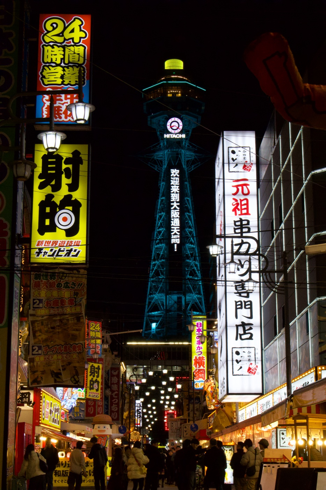</a> | <a href="examples/01-tsutenkaku/after.jpg"></a> |
| **梅里雪山 · 纪实金顶**<br>用 imagegen 直接编辑 DNG 基础显影图，保留原幅构图。降低天空和背阴山坡的颗粒，让峰面呈自然金橙色，并轻提蓝灰色冰川。整体峰形与冰川走向沿用原图，局部雪纹和冰纹由模型重绘。 | <a href="examples/02-meili-snow-mountain/before.png">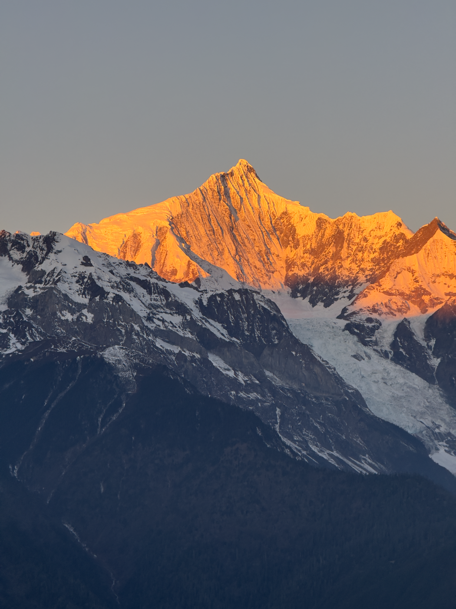</a> | <a href="examples/02-meili-snow-mountain/after.png">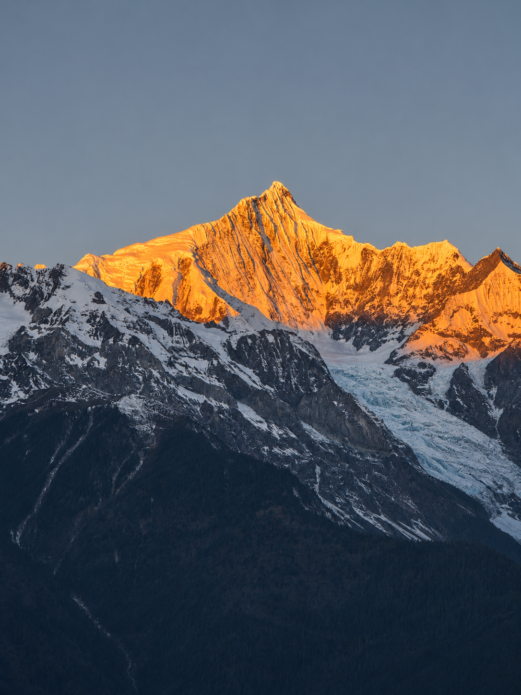</a> |
| **圣米歇尔山 · 糖果色暮光**<br>用 imagegen 精修原幅，让薰衣草蓝、玫粉与奶油桃色的天空呼应潮水倒影。降低暗部和天空的颗粒，提亮背光石墙，让屋顶与城墙分层可见。局部石墙纹理由模型补足。 | <a href="examples/03-mont-saint-michel/before.jpg">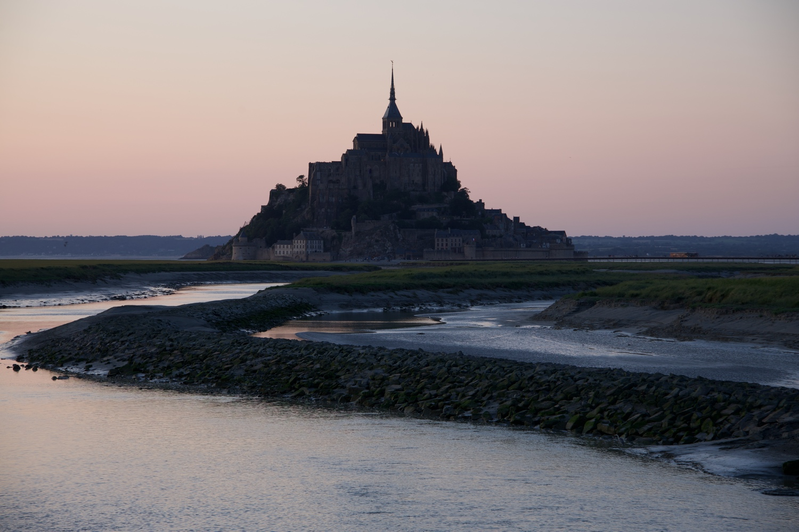</a> | <a href="examples/03-mont-saint-michel/after.png">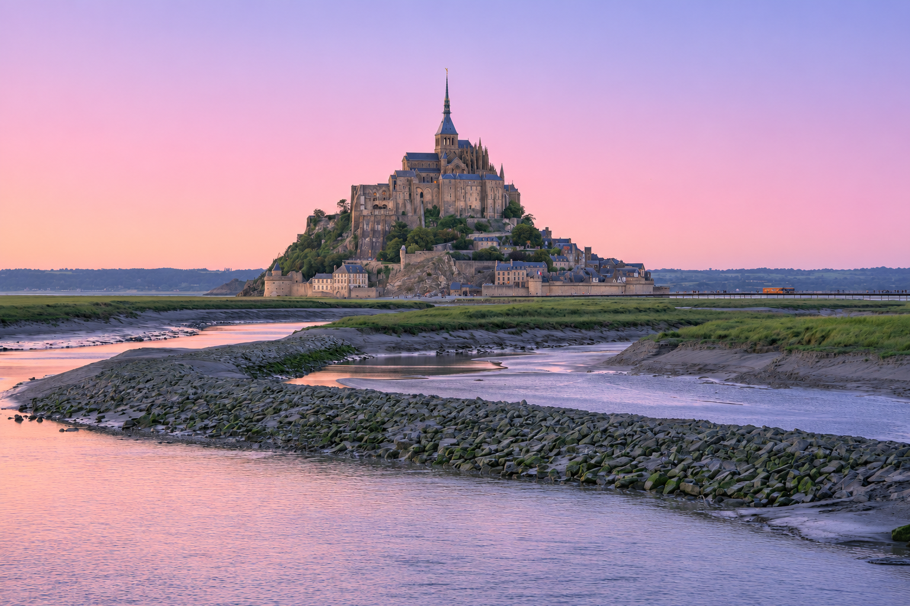</a> |
| **薰衣草人物 · 朦胧暖白（B）**<br>增强花田的柔紫色，用 imagegen 将显眼黄土替换为低矮灰绿植被，柔化远景营造朦胧氛围。衣裙调整为暖白色，并局部修复裙边白色光晕和被误染白的花穗，让人物与花田自然衔接；裙边与花穗交叠处包含生成重建细节。 | <a href="examples/04-lavender-person/before.jpg">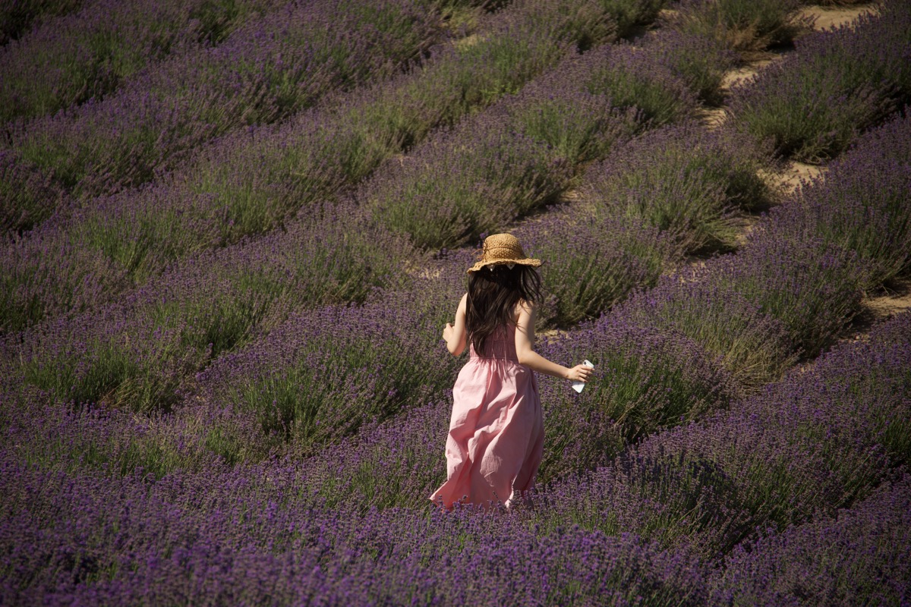</a> | <a href="examples/04-lavender-person/after.jpg">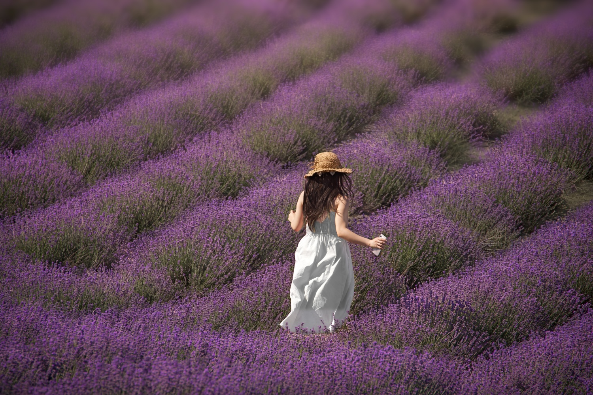</a> |
| **海岸小马 · 清爽海岸（A）**<br>用 imagegen 生成光色参考，结合全尺寸 RAW 局部调整，减轻鬃毛、白色腿毛和腹下的黄褐、黄绿色，保留毛丝、天然黑褐花斑与阴影层次。海水呈清爽蓝色，草地保持自然绿；成片沿用原片纹理与构图。 | <a href="examples/05-coastal-pony/before.jpg">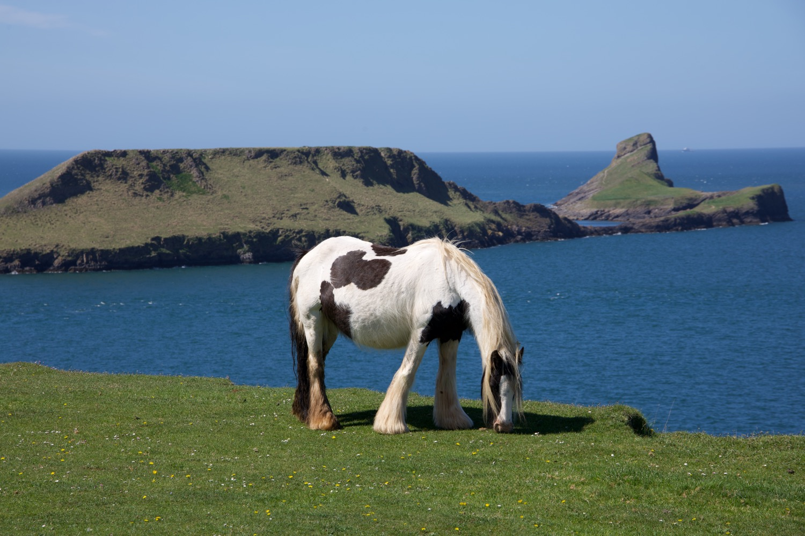</a> | <a href="examples/05-coastal-pony/after.jpg">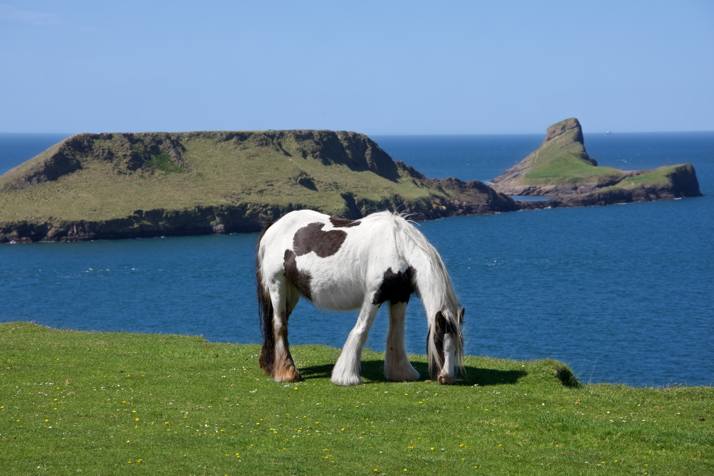</a> |
| **卢浮宫人像 · 移除背景人群**<br>用 imagegen 移除背景游客及其随身物品、投影，重建被遮挡的地面与建筑下部。将原片前景人物合成回来，保留脸部、发丝、墨镜、手和手机等细节，并保留排队栏杆、展示牌与原有构图。 | <a href="examples/06-louvre-portrait/before.jpg">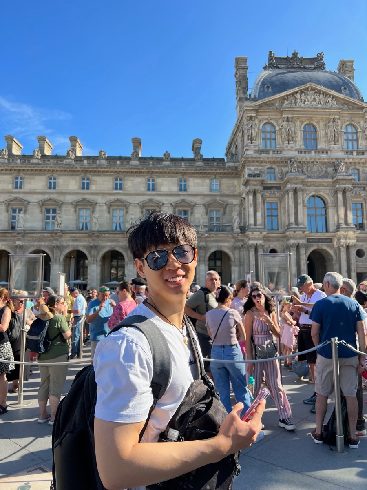</a> | <a href="examples/06-louvre-portrait/after.jpg">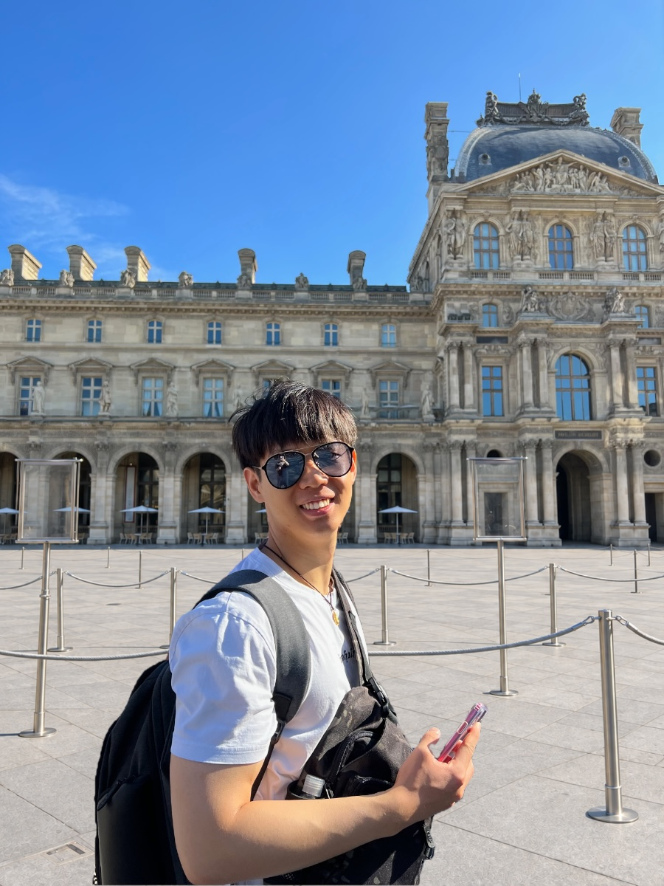</a> |
| **合成人像 · 自然肤质与眼袋淡化**<br>沿用已有痘痘和唇部干皮修复，减轻局部泛红与强反光，并柔化眼袋下缘阴影。用 imagegen 生成光色参考，提取局部光色变化后应用于原有皮肤细节，保留毛孔、绒毛、痣、正常唇纹与卧蚕，保持五官和神态自然。 | <a href="examples/07-beauty-portrait/before.png">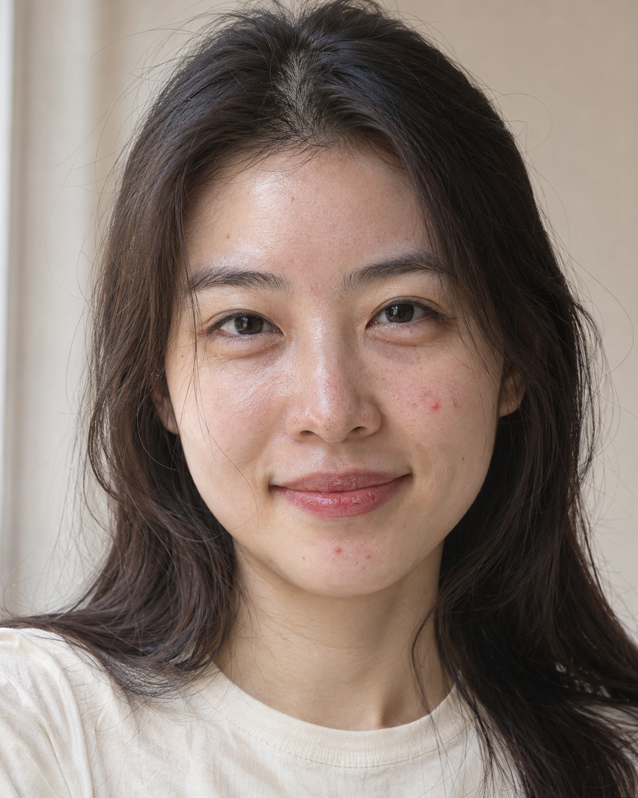</a> | <a href="examples/07-beauty-portrait/after.png">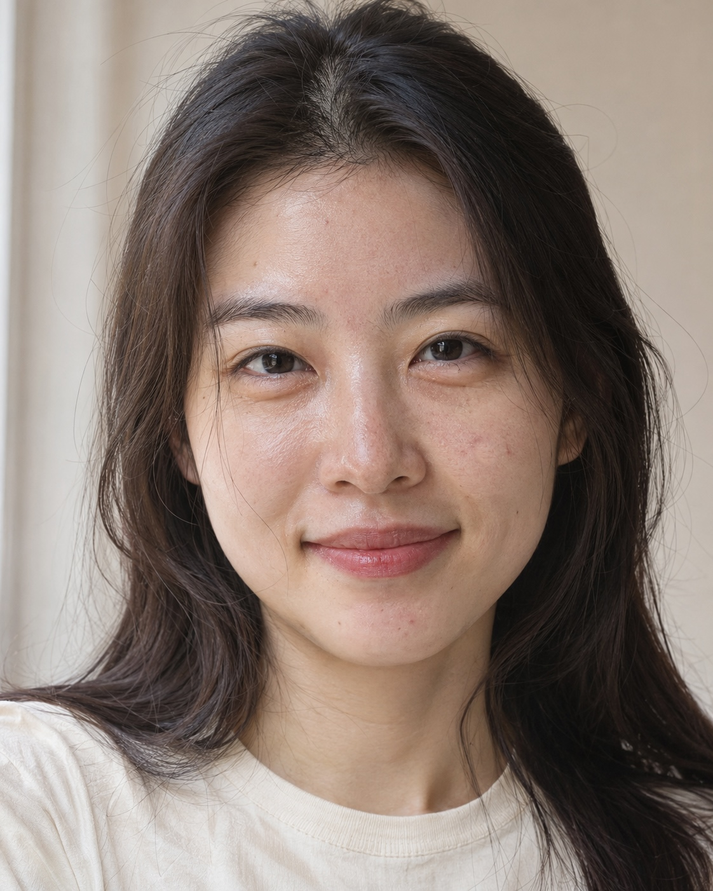</a> |
| **松赞林寺 · 金顶初照（A）**<br>用 imagegen 生成晨光参考，再提取光色变化来增强金顶、受光白墙与原有晨雾的浅金色，保留冷灰前景和全幅构图。建筑细节来自全尺寸 RAW 显影，前景白墙上的原字用蒙版回贴。 | <a href="examples/08-songzanlin-mist/before.jpg">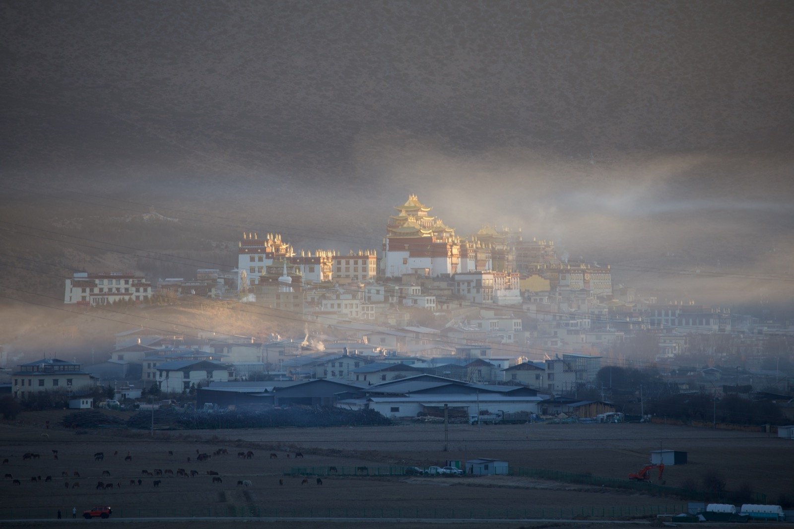</a> | <a href="examples/08-songzanlin-mist/after.jpg">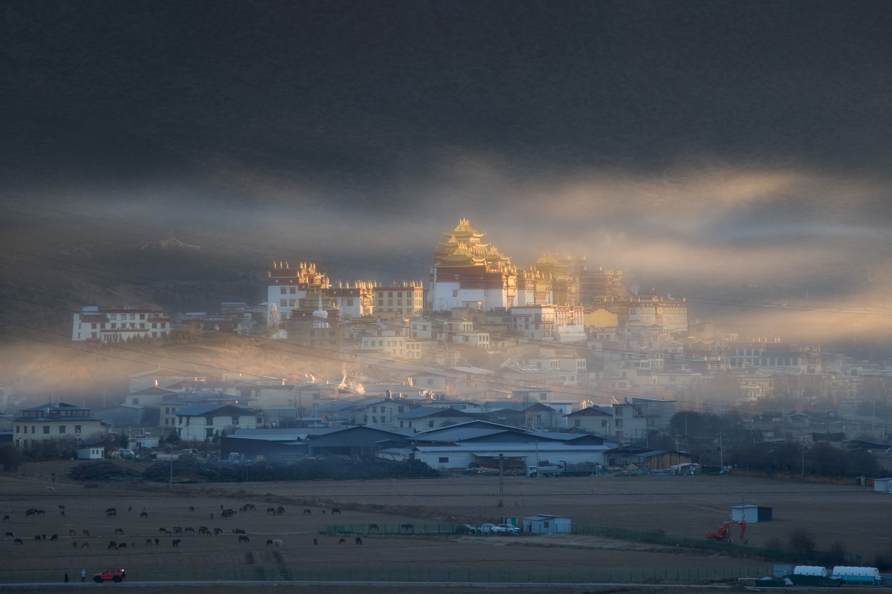</a> |

[美颜案例：原图／第一版／眼袋淡化版局部对照](examples/07-beauty-portrait/under-eye-comparison.jpg)

## 目录

```text
skills/retouch-photo/
  SKILL.md                 技能入口与交互流程
  agents/openai.yaml       Codex 显示信息
  references/              原生处理与参考筛选文档
  scripts/                 Swift 图像助手及 shell 入口
examples/                  已选案例的原图预览与效果图
```

手动复制安装时，请将根目录的 `LICENSE` 一并复制到技能目录。案例图片不属于运行依赖。

## 开发验证

在 macOS 上运行以下回归检查。图像测试使用临时生成的素材，安装测试使用临时技能目录。

```sh
/usr/bin/swift tests/render-regression.swift
sh tests/install-regression.sh
/usr/bin/swift tests/example-metadata.swift examples
```

## 许可

代码、技能说明和文档采用 [MIT 许可证](LICENSE)。`examples/` 下的示例图片由各自的权利人保留权利。
